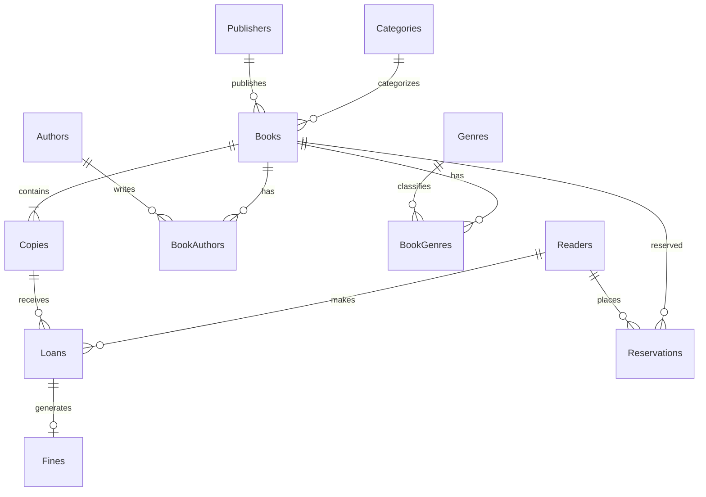

# DER - Biblioteca Hub

Modelo atualizado para corresponder ao schema implementado em `database/scripts/01-schema.sql`.

> Para a entrega, use também o arquivo visual `der-biblioteca-hub.svg`, que pode ser aberto no navegador e enviado como imagem legível.

## Entidades e campos principais

| Entidade | Chave primária | Chaves estrangeiras / regras relevantes |
|---|---|---|
| Categories | CategoryId | Name único |
| Publishers | PublisherId | Name único |
| Genres | GenreId | Name único |
| Books | BookId | CategoryId, PublisherId; ISBN único e válido |
| Authors | AuthorId | Name único |
| BookAuthors | BookId + AuthorId | resolve Books N:N Authors |
| BookGenres | BookId + GenreId | resolve Books N:N Genres |
| Copies | CopyId | BookId; InventoryCode único; Status |
| Readers | ReaderId | RegistrationNumber único; IsSuspended |
| Loans | LoanId | CopyId, ReaderId; ReturnedAt indica devolução |
| Reservations | ReservationId | BookId, ReaderId; Status |
| Fines | FineId | LoanId único; cada empréstimo tem no máximo uma multa |

O diagrama inclui as 10 entidades significativas do cenário e as duas tabelas associativas necessárias à implementação física. `Loans` preserva o histórico; um empréstimo ativo é identificado por `ReturnedAt IS NULL`.

Convenções: `||--o{` representa 0..N; `||--|{` representa 1..N; `||--o|` representa 0..1.
