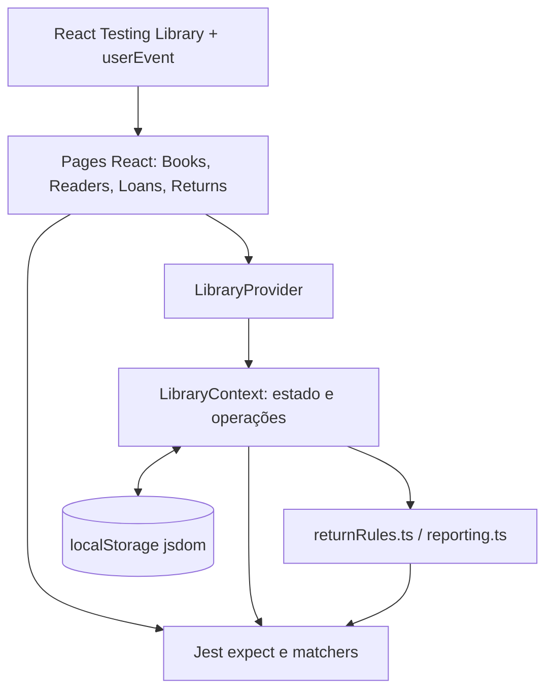

# Biblioteca — Guia Técnico e Didático de Testes Automatizados

## 1. Introdução

Testes automatizados são programas que executam o código da aplicação e verificam, de forma repetível, se o comportamento observado corresponde ao comportamento esperado. Na Biblioteca, eles protegem regras como validação de ISBN, disponibilidade de exemplares, empréstimos, devoluções, cadastro de leitores e persistência do estado.

Eles ajudam a prevenir regressões: uma alteração em uma tela ou no `LibraryContext` pode ser validada novamente sem depender de uma conferência manual completa. Também tornam explícitas as regras de negócio e fornecem uma evidência objetiva para uma apresentação ou revisão de código.

Executar a aplicação mostra que o frontend consegue ser carregado e usado manualmente. Executar os testes verifica cenários previamente definidos, inclusive falhas e casos extremos, com dados controlados. As duas atividades são complementares: o build confirma que o código pode ser empacotado; os testes verificam comportamentos específicos.

## 2. Tecnologias utilizadas

| Tecnologia | Responsabilidade neste projeto |
| --- | --- |
| Jest 30 | Runner dos testes, `describe`, `test`, `expect`, matchers, isolamento e relatório de cobertura. |
| ts-jest 29 | Transforma TypeScript/TSX para que o Jest execute os testes sem gerar arquivos JavaScript permanentes. |
| React Testing Library 16 | Renderiza páginas React em um DOM de teste e oferece consultas orientadas à acessibilidade. |
| `@testing-library/jest-dom` 7 | Adiciona matchers como `toBeInTheDocument()`. |
| `@testing-library/user-event` 14 | Simula ações realistas do usuário, como clique, digitação e limpeza de campos. |
| jsdom | Fornece um DOM simulado para páginas, `localStorage` e componentes React em Node.js. |
| TypeScript | Verifica tipos dos testes e da aplicação; o Jest usa `tsconfig.test.json`. |
| pnpm 10 | Instala dependências e executa os scripts do frontend preservando `pnpm-lock.yaml`. |

O Jest é configurado em `frontend/jest.config.cjs`. Ele usa `ts-jest/presets/default-esm`, ambiente `jsdom`, descobre arquivos `.test.ts` e `.test.tsx`, e executa `frontend/src/test-setup.ts` antes das suítes. O setup importa `@testing-library/jest-dom` e habilita `act` para React 19.

## 3. Arquitetura dos testes

Os testes estão organizados próximos às camadas que exercitam:

```text
frontend/src/
├── context/__tests__/
│   ├── validation.test.ts
│   └── LibraryContext.integration.test.tsx
├── domain/__tests__/
│   ├── returnRules.test.ts
│   └── reporting.test.ts
└── pages/__tests__/
    └── pages.integration.test.tsx
```



Nos testes de página, `renderPage()` monta a página real dentro de `LibraryProvider`. Uma interação como clicar em “Novo empréstimo” chama o estado da página; a confirmação chama `addLoan` no contexto; o contexto atualiza empréstimos, exemplares, livros e leitores, e seus efeitos persistem as coleções no `localStorage`. O teste verifica o resultado observável na interface.

Nos testes de domínio, as funções recebem objetos simples e retornam resultados sem precisar de React ou DOM. Nos testes do contexto, o provider real é montado para verificar a integração entre estado, regras e persistência.

## 4. Tipos de testes implementados

### Testes unitários

Testes unitários verificam uma função ou regra isoladamente, com entradas controladas. Em `validation.test.ts`, são verificadas `validateISBN`, `cleanISBN`, `isValidEmail` e `isValidPhone`, exportadas por `LibraryContext.tsx`. Em `returnRules.test.ts`, são testadas `resolveLoanCopy`, `validateReturnOperation` e `applyReturnOperation`. Em `reporting.test.ts`, são testados status, histórico, CSV e períodos.

Essas funções podem ser executadas sem renderizar a aplicação porque recebem os dados necessários por parâmetro. Por exemplo:

```ts
expect(validateISBN('978-0-306-40615-7')).toBe(true);
expect(validateISBN('978-0-306-40615-8')).toBe(false);
```

O primeiro ISBN tem dígito verificador válido; o segundo não. A diferença evita que um ISBN digitado incorretamente chegue ao cadastro.

### Testes de integração

O arquivo `LibraryContext.integration.test.tsx` monta o `LibraryProvider` real e um componente auxiliar que captura o objeto retornado por `useLibrary`. Assim, os testes chamam operações reais como `addBook`, `updateBook`, `deleteBook`, `addReader`, `addLoan`, `registerReturn` e `updateCopyStatus`.

Eles verificam integração entre estado React, regras, contadores derivados e `localStorage`. Por exemplo, ao emprestar `c-1`, o teste verifica simultaneamente que o exemplar virou `LOANED`, a disponibilidade do livro diminuiu e a quantidade de empréstimos do leitor aumentou.

### Testes de interface

`pages.integration.test.tsx` usa `render()` para montar `BooksPage`, `ReadersPage`, `LoansPage` e `ReturnsPage` dentro do provider. `userEvent` simula ações do usuário, e `screen.getByRole`, `getByPlaceholderText` e `getByText` localizam elementos visíveis ou acessíveis.

Esses testes não chamam diretamente os handlers internos das páginas. Eles clicam, digitam e confirmam, como uma pessoa faria. Assim, um fluxo de quatro etapas do empréstimo testa a interface e o contexto juntos.

Não há mocks de regras de negócio nas suítes atuais. O `localStorage` é o fornecido pelo jsdom e é limpo entre testes de página; isso mantém cada cenário independente.

## 5. Explicação individual dos testes

A suíte atual contém 21 testes executados. O `test.each` de `returnRules.test.ts` aparece como uma declaração no código, mas gera cinco casos independentes no relatório do Jest.

### 5.1 `returnRules.test.ts`

#### 1. `resolve exemplar vinculado e rejeita divergência`

- **Arquivo:** `frontend/src/domain/__tests__/returnRules.test.ts`
- **Objetivo:** validar a associação entre empréstimo e exemplar.
- **Cenário:** um empréstimo aponta para `copy-1`; também são testados um `copyId` inexistente e um código divergente.
- **Preparação:** os objetos `loan` e `copy` são definidos no início do arquivo.
- **Execução:** chama `resolveLoanCopy` três vezes.
- **Verificação:** espera sucesso para o exemplar compatível, `COPY_NOT_FOUND` para o ID inexistente e `COPY_MISMATCH` para dados incompatíveis.
- **Importância:** evita liberar o exemplar errado durante uma devolução.

```ts
expect(resolveLoanCopy(loan, [copy])).toMatchObject({ success: true, copy });
expect(resolveLoanCopy({ ...loan, copyId: 'missing' }, [copy]).code)
  .toBe('COPY_NOT_FOUND');
```

#### 2. `valida data/operação inexistente`

- **Arquivo:** `frontend/src/domain/__tests__/returnRules.test.ts`
- **Objetivo:** impedir devolução de um empréstimo que não existe.
- **Cenário:** ID `missing`, lista de empréstimos vazia.
- **Execução:** chama `validateReturnOperation`.
- **Verificação:** espera `LOAN_NOT_FOUND`.
- **Importância:** impede mutação de estado para uma referência inválida.

#### 3. `valida data/operação já devolvido`

- **Arquivo:** `frontend/src/domain/__tests__/returnRules.test.ts`
- **Objetivo:** impedir uma segunda devolução.
- **Cenário:** empréstimo com status `RETURNED` e `returnDate` preenchida.
- **Verificação:** espera `LOAN_ALREADY_RETURNED`.
- **Importância:** evita duplicidade no histórico e inconsistência de disponibilidade.

#### 4. `valida data/operação data inválida`

- **Arquivo:** `frontend/src/domain/__tests__/returnRules.test.ts`
- **Objetivo:** rejeitar formato de data que não seja `YYYY-MM-DD`.
- **Cenário:** valor `05/11/2026`.
- **Verificação:** espera `INVALID_RETURN_DATE`.
- **Importância:** protege comparações e persistência contra datas malformadas.

#### 5. `valida data/operação antes do empréstimo`

- **Arquivo:** `frontend/src/domain/__tests__/returnRules.test.ts`
- **Objetivo:** impedir devolução anterior à data do empréstimo.
- **Cenário:** empréstimo em `2026-11-01`, devolução em `2026-10-31`.
- **Verificação:** espera `RETURN_BEFORE_LOAN`.
- **Importância:** preserva a coerência temporal do histórico.

#### 6. `valida data/operação futura`

- **Arquivo:** `frontend/src/domain/__tests__/returnRules.test.ts`
- **Objetivo:** impedir devolução depois do dia informado como hoje no teste.
- **Cenário:** `today` é `2026-11-10` e a devolução é `2026-11-11`.
- **Verificação:** espera `RETURN_IN_FUTURE`.
- **Importância:** evita registrar recebimento que ainda não ocorreu.

Os cinco casos anteriores são gerados por:

```ts
test.each([
  ['inexistente', 'missing', '2026-11-05', 'LOAN_NOT_FOUND'],
  ['já devolvido', 'returned', '2026-11-05', 'LOAN_ALREADY_RETURNED'],
  ['data inválida', 'loan-1', '05/11/2026', 'INVALID_RETURN_DATE'],
  ['antes do empréstimo', 'loan-1', '2026-10-31', 'RETURN_BEFORE_LOAN'],
  ['futura', 'loan-1', '2026-11-11', 'RETURN_IN_FUTURE'],
])(...);
```

#### 7. `aplica devolução e libera o exemplar`

- **Arquivo:** `frontend/src/domain/__tests__/returnRules.test.ts`
- **Objetivo:** verificar a mutação calculada para uma devolução válida.
- **Cenário:** empréstimo aberto e exemplar `LOANED`, com data válida.
- **Execução:** chama `applyReturnOperation`.
- **Verificação:** espera sucesso, empréstimo `RETURNED`, `returnDate` preenchida e cópia `AVAILABLE` em `nextCopies`.
- **Importância:** protege a transição central que devolve disponibilidade ao acervo.

#### 8. `bloqueia devolução quando exemplar não está emprestado`

- **Arquivo:** `frontend/src/domain/__tests__/returnRules.test.ts`
- **Objetivo:** impedir devolução quando o exemplar já está disponível.
- **Verificação:** espera `COPY_NOT_LOANED`.
- **Importância:** evita liberar ou alterar duas vezes o mesmo exemplar.

### 5.2 `reporting.test.ts`

#### 9. `deriva status ativo, atrasado e devolvido`

- **Arquivo:** `frontend/src/domain/__tests__/reporting.test.ts`
- **Objetivo:** conferir `getDerivedLoanStatus` em três momentos.
- **Preparação:** empréstimo com vencimento em `2026-11-05` e datas de teste em `04/11` e `06/11`.
- **Verificação:** os resultados são `ACTIVE`, `OVERDUE` e `RETURNED`.
- **Importância:** garante que listagens e relatórios exibam o status correto.

#### 10. `identifica devolução atrasada e ordena movimentos`

- **Arquivo:** `frontend/src/domain/__tests__/reporting.test.ts`
- **Objetivo:** verificar atraso e ordenação do histórico.
- **Cenário:** o mesmo empréstimo é representado como devolvido em `2026-11-06`, depois de vencer em `2026-11-05`.
- **Verificação:** `wasLoanReturnedLate` retorna `true` e `buildMovementHistory` retorna os IDs na ordem mais recente primeiro.
- **Importância:** evita relatórios cronologicamente incorretos e classificação errada de atraso.

#### 11. `escapa CSV e filtra períodos`

- **Arquivo:** `frontend/src/domain/__tests__/reporting.test.ts`
- **Objetivo:** verificar exportação segura de aspas e filtros de data.
- **Execução:** testa `escapeCsvCell`, `createCsv` e `isDateInPeriod`.
- **Verificação:** aspas são duplicadas no CSV, o BOM e separador aparecem, e filtros de mês/ano/valor ausente retornam o esperado.
- **Importância:** protege arquivos exportados e consultas de relatórios.

### 5.3 `validation.test.ts`

#### 12. `valida e normaliza ISBN-10 e ISBN-13`

- **Arquivo:** `frontend/src/context/__tests__/validation.test.ts`
- **Objetivo:** validar dois ISBNs corretos, rejeitar um ISBN-13 incorreto e remover separadores.
- **Verificação:** `validateISBN` retorna `true`, `true`, `false`; `cleanISBN` produz `9780306406157`.
- **Importância:** evita duplicidade ou cadastro de livro com identificador inválido.

#### 13. `aceita campos de contato vazios e rejeita formatos inválidos`

- **Arquivo:** `frontend/src/context/__tests__/validation.test.ts`
- **Objetivo:** validar a regra de campos opcionais e formatos.
- **Cenário:** e-mail/telefone vazios, e-mail correto/incorreto e telefone correto/curto.
- **Verificação:** vazios são aceitos, o e-mail `reader@example.com` e telefone `(11) 98765-4321` são válidos, `reader@` e `123` são rejeitados.
- **Importância:** evita bloquear campos opcionais e evita armazenar contatos obviamente inválidos.

### 5.4 `LibraryContext.integration.test.tsx`

#### 14. `cadastra, edita e exclui livro sem empréstimos`

- **Arquivo:** `frontend/src/context/__tests__/LibraryContext.integration.test.tsx`
- **Objetivo:** verificar o ciclo de vida de um livro sem histórico.
- **Preparação:** provider real, `localStorage` limpo, livro com duas cópias.
- **Execução:** chama `addBook`, `updateBook` e `deleteBook` dentro de `act`.
- **Verificação:** livro/cópias são criados, título e quantidade são alterados e o livro é removido.
- **Importância:** protege CRUD e sincronização de exemplares.

#### 15. `bloqueia ISBN duplicado, leitor inválido e leitor duplicado`

- **Arquivo:** `frontend/src/context/__tests__/LibraryContext.integration.test.tsx`
- **Objetivo:** conferir bloqueios de cadastro.
- **Execução:** tenta adicionar ISBN duplicado, leitor sem nome, leitor com contato inválido, depois cadastra leitor válido e tenta identificador repetido sem diferenciar maiúsculas/minúsculas.
- **Verificação:** as tentativas inválidas retornam `success: false`; o cadastro válido retorna sucesso.
- **Importância:** preserva integridade do catálogo e unicidade dos leitores.

#### 16. `empresta exemplar disponível, atualiza disponibilidade e devolve`

- **Arquivo:** `frontend/src/context/__tests__/LibraryContext.integration.test.tsx`
- **Objetivo:** testar o ciclo integrado de empréstimo/devolução.
- **Preparação:** leitor regular `r-4`, exemplar disponível `c-1`, datas de novembro de 2026.
- **Execução:** chama `addLoan`, tenta repetir o mesmo empréstimo e chama `registerReturn`.
- **Verificação:** a cópia vira `LOANED`, a disponibilidade diminui, o contador do leitor aumenta; a repetição falha; depois a cópia volta a `AVAILABLE` e o contador retorna a zero.
- **Importância:** protege o fluxo mais importante da circulação.

#### 17. `persiste estado no localStorage e impede alterações perigosas`

- **Arquivo:** `frontend/src/context/__tests__/LibraryContext.integration.test.tsx`
- **Objetivo:** verificar persistência e restrições.
- **Execução:** tenta marcar exemplar emprestado como disponível e excluir livro com histórico.
- **Verificação:** ambas as operações são rejeitadas e a coleção de livros persistida ainda contém `b-1`.
- **Importância:** evita inconsistência entre cópias, empréstimos e histórico.

### 5.5 `pages.integration.test.tsx`

#### 18. `BooksPage renderiza a listagem real e permite pesquisar um livro`

- **Arquivo:** `frontend/src/pages/__tests__/pages.integration.test.tsx`
- **Objetivo:** verificar listagem e busca observáveis.
- **Execução:** renderiza `BooksPage`, localiza o campo de filtro por placeholder e digita `Redes`.
- **Verificação:** “Redes de Computadores” permanece visível e “Código Limpo” deixa de aparecer.
- **Importância:** protege a consulta principal do acervo.

#### 19. `ReadersPage cadastra leitor válido e mostra validação de campo obrigatório`

- **Arquivo:** `frontend/src/pages/__tests__/pages.integration.test.tsx`
- **Objetivo:** verificar formulário de leitor e validação obrigatória do nome na interface; formatos de e-mail/telefone são cobertos pelos testes unitários de validação.
- **Execução:** abre “Novo Leitor”, tenta cadastrar vazio, verifica o erro, preenche nome, identificador e e-mail e cadastra.
- **Verificação:** a mensagem de nome obrigatório aparece e o novo leitor aparece na listagem após o cadastro.
- **Importância:** confirma que a tela encaminha corretamente dados válidos e inválidos ao contexto.

#### 20. `LoansPage realiza empréstimo pelo fluxo de quatro etapas`

- **Arquivo:** `frontend/src/pages/__tests__/pages.integration.test.tsx`
- **Objetivo:** simular o wizard de empréstimo completo.
- **Execução:** clica em “Novo empréstimo”, escolhe leitor, livro, `EX-001`, avança pelas datas/revisão e confirma.
- **Verificação:** `EX-001` aparece na listagem de empréstimos.
- **Importância:** protege a integração entre seleção visual, validação e `addLoan`.

#### 21. `ReturnsPage registra devolução e atualiza a aba de histórico`

- **Arquivo:** `frontend/src/pages/__tests__/pages.integration.test.tsx`
- **Objetivo:** simular recebimento de exemplar pela tela.
- **Execução:** abre a primeira devolução pendente, informa `2026-11-04`, confirma e seleciona “Histórico”.
- **Verificação:** o modal fecha, o histórico aparece e o exemplar `EX-008` está presente.
- **Importância:** protege a atualização visual após uma operação de devolução.

## 6. Funcionamento interno dos testes

### `describe`, `test` e `it`

`describe()` agrupa casos relacionados. `test()` define um caso executável; `it()` seria um alias semântico. O projeto utiliza `describe` e `test`, por exemplo `describe('regras de devolução', () => { ... })`.

### `expect` e matchers

`expect(valor)` inicia uma afirmação. Os matchers usados incluem:

- `toBe(true)`: igualdade simples por identidade/valor.
- `toEqual(...)`: igualdade estrutural de objetos/arrays.
- `toMatchObject(...)`: verifica apenas parte de um objeto.
- `toHaveLength(...)`: verifica tamanho.
- `toBeInTheDocument()`: matcher do jest-dom para presença no DOM.

### `render` e `screen`

`render(<LibraryProvider>...</LibraryProvider>)` cria a árvore React em jsdom. `screen` consulta o DOM global do teste. Consultas por papel, texto e placeholder aproximam o teste da forma como usuários e tecnologias assistivas encontram elementos.

### `userEvent`

`userEvent.setup()` cria um usuário simulado. Chamadas como `user.click(...)`, `user.type(...)` e `user.clear(...)` são assíncronas e aguardadas com `await`.

### `waitFor`

`waitFor` repete uma verificação até que ela passe ou atinja o timeout. É usado quando a UI precisa refletir uma atualização de estado. Alguns testes conseguem verificar o DOM imediatamente depois de uma ação `userEvent`; outros usam `waitFor` para aguardar a renderização.

### `act`

`act` agrupa atualizações de estado React nos testes do `LibraryContext`. No teste de integração, chamadas como `addBook` e `registerReturn` mudam o estado do provider, por isso são executadas dentro de `await act(async () => { ... })`. O React Testing Library já envolve muitas interações de usuário em `act` internamente.

### Mocks

As suítes atuais não usam mocks para as regras de negócio nem para o `LibraryContext`. Isso é intencional: o objetivo é verificar as implementações reais. O ambiente externo é jsdom, que fornece DOM e `localStorage` simulados.

### Setup, teardown e isolamento

`src/test-setup.ts` é executado antes das suítes. No teste de páginas, `beforeEach` implícito da função `renderPage` chama `localStorage.clear()`, e `afterEach` limpa novamente. Cada chamada a `render` cria uma árvore independente; os dados iniciais são recarregados pelo provider.

Como a suíte de páginas combina várias interações assíncronas de `userEvent`, ela define explicitamente `jest.setTimeout(10000)`. Isso evita que o tempo padrão de 5 segundos cause falso negativo em execução mais carregada, sem alterar a regra testada.

### Preparação → Execução → Verificação

1. **Preparação:** criar dados, limpar `localStorage` e renderizar provider/página.
2. **Execução:** chamar a função sob teste ou simular clique/digitação com `userEvent`.
3. **Verificação:** usar `expect` para comparar retorno, estado refletido ou elementos visíveis.

## 7. Demonstração prática

### Roteiro de fala — aproximadamente 5 a 8 minutos

1. **Introdução (40–60 s):** “Os testes automatizados verificam comportamentos da Biblioteca de forma repetível. Eles não substituem abrir a aplicação, mas permitem comprovar regras críticas sem repetir manualmente todos os cenários.”
2. **Estrutura (50–70 s):** mostrar `context/__tests__`, `domain/__tests__` e `pages/__tests__`. Explicar que domínio é unitário, contexto é integração e páginas usam Testing Library.
3. **Teste unitário de devolução (60–80 s):** abrir `returnRules.test.ts`, mostrar `applyReturnOperation`, explicar que uma cópia emprestada precisa virar disponível e que o retorno é um novo estado calculado.
4. **Teste de integração de empréstimo (80–100 s):** mostrar `LibraryContext.integration.test.tsx`, explicar que `addLoan` altera exemplar, livro e leitor e que a devolução desfaz essas alterações.
5. **Teste de interface (80–100 s):** mostrar o wizard em `pages.integration.test.tsx`; explicar que o teste clica, seleciona `EX-001`, avança etapas e confirma como um usuário.
6. **Execução (40–60 s):** executar `corepack pnpm@10 test` e mostrar “5 passed, 21 passed”.
7. **Cobertura (40–60 s):** executar `corepack pnpm@10 test:coverage`, explicar statements/branches e destacar que o escopo coleta contexto e domínio, não todas as páginas.
8. **Conclusão (30–40 s):** “Os testes protegem validações, circulação e integração. A cobertura é uma métrica de apoio; a qualidade vem de cenários relevantes e verificações observáveis.”

## 8. Execução dos testes

Execute os comandos a partir de `frontend/`:

```bash
corepack pnpm@10 test
corepack pnpm@10 test:watch
corepack pnpm@10 test:coverage
corepack pnpm@10 exec tsc --noEmit
corepack pnpm@10 build
```

- `test`: executa todas as suítes uma vez, em série (`--runInBand`). Resultado atual: 5 suítes e 21 testes aprovados.
- `test:watch`: mantém o Jest observando alterações para desenvolvimento interativo.
- `test:coverage`: executa a suíte e cria o relatório em `frontend/coverage/` (artefato ignorado pelo Git).
- `tsc --noEmit`: verifica tipos sem gerar JavaScript.
- `build`: verifica o empacotamento de produção pelo Vite.

## 9. Cobertura de código

Cobertura indica quanto do código instrumentado foi executado pelos testes; não mede sozinha se as afirmações são boas.

- **Statements:** instruções executadas.
- **Branches:** caminhos condicionais percorridos, como `if/else`.
- **Functions:** funções chamadas.
- **Lines:** linhas executadas.

Última execução validada em 2026-11-04:

| Escopo | Statements | Branches | Functions | Lines |
| --- | ---: | ---: | ---: | ---: |
| Geral configurado | 72,54% | 57,30% | 75,55% | 73,68% |
| `LibraryContext.tsx` | 70,41% | 52,00% | 72,41% | 71,53% |
| `domain/` | 83,72% | 77,02% | 94,73% | 84,61% |
| `returnRules.ts` | 81,25% | 79,54% | 88,88% | 81,81% |
| `reporting.ts` | 86,84% | 73,33% | 100% | 88,23% |

O escopo de `collectCoverageFrom` em `jest.config.cjs` inclui `src/context/LibraryContext.tsx` e `src/domain/**/*.ts`; as páginas React não entram na cobertura geral atual. Cobertura alta não garante ausência de bugs: um teste pode executar uma linha sem verificar corretamente o resultado. Também não é necessário buscar 100% artificialmente; é mais importante cobrir regras críticas, falhas e integrações relevantes.

## 10. Limitações e melhorias futuras

- A `BooksPage` atual renderiza listagem/pesquisa, mas não renderiza um drawer visual de cadastro/edição/exclusão; CRUD do livro é coberto pelo `LibraryContext`, não por interação da página.
- Nem todos os caminhos raros de `LibraryContext` estão cobertos, especialmente ramos de edição, exclusão, arquivamento e tratamento de dados legados.
- Não há testes específicos para todas as páginas secundárias, componentes visuais isolados ou navegação completa da aplicação.
- O `localStorage` é simulado em memória; isso não substitui testes de um backend ou de múltiplos usuários concorrentes.
- O aviso TS151001 do ts-jest sobre `esModuleInterop` não impede as validações atuais.
- O futuro backend ASP.NET Core pode adicionar testes unitários e de integração com xUnit para domínio, casos de uso, persistência e endpoints.
- A documentação deve ser atualizada sempre que testes, regras de negócio ou comandos de validação mudarem.
